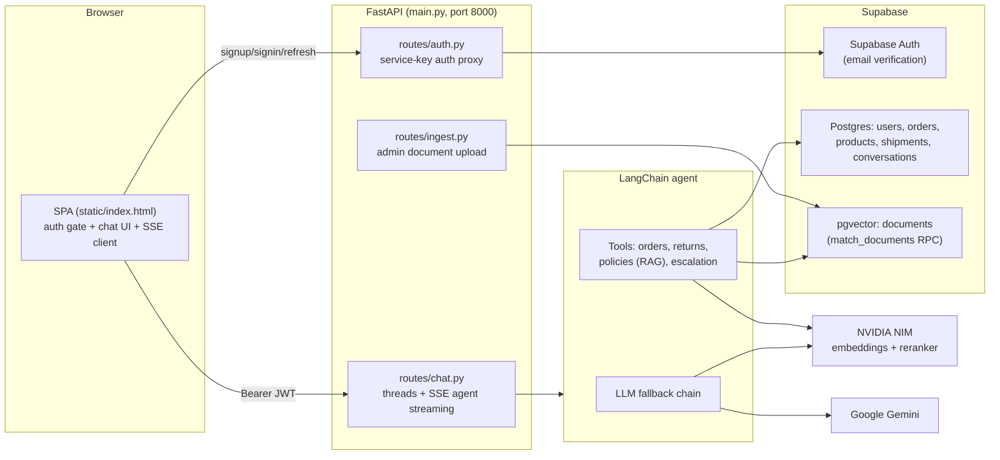

# Orderly

AI-powered e-commerce customer support agent. Customers sign in, select an order, and chat with a LangChain agent that can look up orders, check return eligibility, cancel orders, answer policy questions via RAG, and escalate to a human.

## Features

- Agentic chat with real-time token streaming (SSE)
- Order lookup, tracking, cancellation, and return-eligibility tools
- RAG over store policy documents (PDF / CSV / XLSX / DOCX / Markdown)
- Supabase auth (signup, email verification, sign-in, session refresh)
- Single-page frontend served by FastAPI — no build step, no keys in the browser
- LLM fallback chain so quota exhaustion on one provider does not break chat
- Per-user conversation persistence with an escalation cap after 20 turns

## Architecture



### Chat flow

1. The SPA sends `POST /chat/{thread_id}` with the user's Supabase access token in the `Authorization` header.
2. `dependencies.get_current_user` validates the token against Supabase Auth and loads the `users` profile row.
3. The route loads the conversation from `conversations`, blocks it if already escalated, and truncates history if the 20-turn escalation cap is reached.
4. `config.llm` (a fallback chain) plus the customer tools are assembled into a LangChain agent via `create_agent`.
5. The agent streams run events, which the route forwards to the browser as Server-Sent Events: `token`, `tool_call`, `tool_result`, `escalation`, `error`, `done`.
6. Final messages are serialized back into `conversations.all_messages`.

### Auth flow

The browser never holds a Supabase key. All auth calls go through `routes/auth.py`, which uses the service key server-side:

1. Signup (`POST /auth/signup`) creates the user via Supabase Auth; Supabase sends a verification email.
2. The verification link redirects to the app. The SPA handles both redirect styles: implicit-flow tokens in the URL hash and `token_hash` query params (custom email templates), the latter verified via `POST /auth/verify`.
3. The session is stored in `localStorage` and refreshed through `POST /auth/refresh` before expiry.
4. Data queries run server-side with the service key on `supabase_client`.

Note: auth calls use a dedicated `supabase_auth_client`. This is deliberate — supabase-py rewrites the shared client's REST `Authorization` header to the signed-in user's JWT after auth events, which would cause all subsequent PostgREST queries to run under RLS.

### RAG flow

1. Documents are loaded and split in `services._load_and_chunk_documents` (markdown split by headers, everything else recursively at 1000 chars / 150 overlap).
2. Chunks get `source`, `version`, `effective_date`, and `status` metadata, and previously ingested chunks for the same source are archived.
3. Embeddings (NVIDIA `nemotron-3-embed-1b`) are stored in Supabase pgvector via `SupabaseVectorStore`.
4. At query time the `search_order_policies` tool retrieves top-10 active chunks (similarity threshold 0.3), reranks to top-5 with NVIDIA `llama-nemotron-rerank-vl-1b-v2`, then answers through the grounded `qa_prompt` with inline source citations.

### LLM fallback chain

`config.llm` is a `RunnableWithFallbacks` — if one provider fails (quota, outage), the turn continues on the next:

1. `gemini-3.5-flash-lite` (primary)
2. `gemini-3.5-flash` (separate per-model quota bucket)
3. `openai/gpt-oss-20b` on NVIDIA NIM (separate provider entirely)

## Agent tools

| Tool | Purpose |
| --- | --- |
| `get_order_details` | Status, tracking, items, shipment info for the selected order |
| `list_customer_orders` | Recent orders for the authenticated customer |
| `cancel_order` | Cancels orders in `placed` or `processing` status |
| `check_order_return_eligibility` | 30-day window rules, final-sale exclusions, refund amount |
| `search_order_policies` | RAG over ingested policy documents with citations |
| `escalate_to_human` | Closes the thread and hands off to a human (return_direct) |

## Data model (Supabase)

| Table | Purpose |
| --- | --- |
| `users` | Profile rows keyed by Supabase auth user id, with `role` for admin access |
| `orders` | `order_number`, `customer_id`, `status`, `total`, `currency`, `placed_at`, `delivered_at` |
| `order_items` | Line items linking orders to products |
| `products` | Catalog with `specs`, `is_final_sale` |
| `shipments` | Carrier, tracking number, expected delivery, last status |
| `conversations` | `thread_id`, `user_id`, `all_messages` (LangChain-serialized JSON incl. thread metadata) |
| `documents` | pgvector store for policy chunks + `match_documents` RPC |

## API

| Method | Path | Auth | Description |
| --- | --- | --- | --- |
| GET | `/health` | none | Liveness probe |
| GET | `/` | none | Serves the SPA |
| POST | `/auth/signup` | none | Create account (sends verification email) |
| POST | `/auth/signin` | none | Password sign-in |
| POST | `/auth/refresh` | none | Refresh access token |
| POST | `/auth/resend` | none | Resend verification email |
| POST | `/auth/verify` | none | Verify `token_hash` from email link |
| GET | `/auth/me` | Bearer | Current user profile |
| GET | `/auth/confirm` | none | Landing page for custom email templates |
| POST | `/chat/create_thread` | Bearer | Create a conversation for an order |
| POST | `/chat/{thread_id}` | Bearer | Send a message, streams SSE |
| GET | `/chat/{thread_id}/history` | Bearer | Conversation history |
| GET | `/chat/threads` | Bearer | User's conversations |
| GET | `/orders/my` | Bearer | User's orders |
| POST | `/ingest` | Bearer (admin) | Upload policy documents for RAG |

## Setup

Requires Python 3.12 and [uv](https://docs.astral.sh/uv/).

```bash
uv sync
```

Create `.env`:

```dotenv
SUPABASE_URL=https://<project>.supabase.co
SUPABASE_SERVICE_KEY=<service-role-key>
NVIDIA_API_KEY=<nvidia-nim-key>
GOOGLE_API_KEY=<google-ai-studio-key>

# Optional overrides
GEMINI_MODEL=gemini-3.5-flash-lite
GEMINI_FALLBACK_MODEL=gemini-3.5-flash
NVIDIA_LLM_MODEL=openai/gpt-oss-20b
```

Supabase dashboard:
- Enable the Email provider with "Confirm email" on.
- Authentication -> URL Configuration: Site URL `http://localhost:8000`, Redirect URLs `http://localhost:8000/**`.

Seed demo data and ingest the policy documents in `docs/`:

```bash
uv run python seed_data.py --customer-id <supabase-auth-user-uuid>
uv run python ingest_docs.py
```

Run the app:

```bash
uv run uvicorn main:app --reload --port 8000
```

Open http://localhost:8000, create an account, click the verification link, then chat.

## Project structure

```
Order-bot/
├── main.py            # FastAPI app: routers, static serving, /health
├── config.py          # env, logging, Supabase clients, LLM chain, vector store
├── dependencies.py    # JWT auth, current-user resolution, role checks
├── prompt.py          # agent system prompt + grounded RAG qa_prompt
├── tools.py           # agent tools (orders, returns, RAG, escalation)
├── services.py        # document loading, chunking, vector-store ingestion
├── schemas.py         # Pydantic request/response models
├── seed_data.py       # demo products, orders, items, shipments
├── ingest_docs.py     # CLI ingestion for docs/
├── docs/              # policy documents (md, pdf, csv, xlsx)
├── routes/
│   ├── auth.py        # service-key auth proxy
│   ├── chat.py        # threads, SSE agent streaming, orders
│   └── ingest.py      # admin document upload endpoint
└── static/
    └── index.html     # SPA: auth gate, chat UI, SSE client
```
